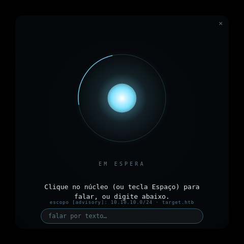

# hacker.ia 🎙️🛡️

**Assistente de pentest por voz, estilo Jarvis, para Kali Linux.**
Você **fala**, ele **ouve**, pensa com um modelo de IA e **responde em voz** (pt-BR),
ajudando no seu laboratório de segurança — sempre dentro de um escopo autorizado.

<p align="center">
  
</p>

---

## ✨ O que é

Um app de desktop (Electron) com um **orb reativo minimalista**. O fluxo é simples:

1. Você clica no núcleo (ou aperta **Espaço**) e fala.
2. O áudio vira texto (reconhecimento de fala **offline**).
3. Um modelo de IA raciocina sobre o pedido, com a persona do Jarvis e o seu escopo.
4. A resposta é falada em voz alta com uma **voz neural pt-BR**.

Tudo roda **localmente** no seu Kali (exceto se você escolher o cérebro na nuvem).

---

## 🧠 Arquitetura

```
  microfone ──► arecord ──► whisper.cpp  (ouvir / fala→texto, offline)
                                 │ texto
                                 ▼
                          CÉREBRO (escolhível)
                   ┌──────────────┴───────────────┐
             "claude"                          "ollama"
        Claude Code (nuvem)              modelo local (offline)
        ótimo p/ estudo;                 p/ lado ofensivo em
        recusa exploração                lab/CTF; sem safeguards
                   └──────────────┬───────────────┘
                                 │ resposta (texto)
                                 ▼
                     Piper  (voz neural pt-BR) ──► aplay ──► alto-falante
                                 ▲
                                 │
                    Electron — orb minimalista reativo
                    (estados: espera / ouvindo / pensando / falando)
```

A **persona** e a **regra de escopo** ficam em `CLAUDE.md`; os alvos autorizados em
`scope.yaml`. O cérebro é **plugável** no `config.json`.

---

## 📦 Requisitos

- **Kali Linux** (ou outra distro Linux com áudio).
- **Node.js + npm** (`sudo apt install -y nodejs npm`).
- **Áudio funcionando** (microfone + alto-falante; em VM, habilite o áudio na VM).
- Para o cérebro:
  - **Ollama** (modelo local) — recomendado para o lado ofensivo; **ou**
  - **Claude Code** (`claude` na linha de comando) — para estudo.

---

## 🚀 Instalação

```bash
git clone https://github.com/Hiagolim11/hacker.ia
cd hacker.ia
bash setup.sh        # instala Electron, baixa Piper (voz) + modelo whisper (ouvido)
npm run check        # mostra o que está OK / faltando
npm start
```

> O `setup.sh` baixa ~500 MB (modelo de fala + voz neural). Esses arquivos **não** vêm
> no repositório de propósito — são recriados pelo script.

### Compilar o whisper.cpp (ouvido), se faltar
```bash
sudo apt-get install -y cmake
git clone https://github.com/ggerganov/whisper.cpp
cd whisper.cpp && cmake -B build && cmake --build build -j --config Release
cp build/bin/whisper-cli ~/hacker.ia/whisper-cli
```

---

## 🧩 Os dois cérebros

Escolha em `config.json → "brain"`:

### `ollama` — local, offline, para o lado ofensivo (recomendado)
Um modelo rodando na sua máquina, **sem os filtros de uso da nuvem**. É o caminho certo
para auxílio ofensivo em **lab/CTF seu**.

```bash
curl -fsSL https://ollama.com/install.sh | sh
ollama pull llama3.2:3b     # leve, roda em CPU (~2 GB)
# config.json: "brain": "ollama"
```
> Sem GPU e com pouca RAM? Fique em modelos **3B** (`llama3.2:3b`, `qwen2.5:3b`).
> Com GPU/mais RAM, troque `ollamaModel` por algo maior (`qwen2.5:7b`) para respostas melhores.

### `claude` — Claude Code (nuvem), para estudo
Excelente para **aprender**: explica conceitos, flags de ferramentas, interpreta saídas.
Por **política da plataforma**, recusa pedidos com cara de exploração (erro `[cyber]`) —
isso é esperado e não é contornável. Use o modelo **Sonnet** (já configurado), que é menos
restritivo que o Opus.

---

## 🎮 Uso

| Ação | Como |
|------|------|
| Falar (push-to-talk) | Clique no **núcleo** ou aperte **Espaço** → fale → de novo para processar |
| Falar por texto | Digite no campo de baixo e **Enter** |
| Interromper a fala | **Esc** |
| Mover a janela | Arraste (é sem moldura) |
| Fechar | **✕** |

Os estados do orb: **em espera · ouvindo · pensando · falando**.

---

## ⚙️ Configuração (`config.json`)

| Campo | O que é |
|-------|---------|
| `brain` | `"ollama"` (local) ou `"claude"` (nuvem) |
| `ollamaModel` | modelo do Ollama (ex.: `llama3.2:3b`) |
| `claudeArgs` | argumentos do Claude Code (modelo, etc.) |
| `whisperBin` / `whisperModel` | binário e modelo de fala→texto |
| `piperBin` / `piperModel` | binário e voz neural (pt-BR) |
| `maxRecordSeconds` | tempo máximo de gravação por fala |
| `brainTimeoutMs` | tempo máximo esperando o cérebro responder |

A persona e o estilo das respostas faladas ficam em `CLAUDE.md`.

---

## 🛡️ Escopo e uso responsável

- `scope.yaml` lista os alvos **autorizados**. O assistente só orienta ações contra o que
  estiver na lista; o resto é recusado.
- Modo **`advisory`** (padrão): ele **orienta e explica**, você executa os comandos.
- **Use apenas em ambientes autorizados:** seu próprio laboratório, máquinas de CTF, ou
  um engajamento com **autorização por escrito**. Testar sistemas de terceiros sem
  permissão é crime. O autor não se responsabiliza por uso indevido.

---

## 📁 Estrutura

```
hacker.ia/
├── main.js            # processo principal (loop de voz + escolha do cérebro)
├── preload.js         # ponte segura main ↔ interface
├── renderer/          # o orb minimalista (HTML/Canvas)
├── CLAUDE.md          # persona + regra de escopo
├── scope.yaml         # alvos autorizados
├── config.json        # binários, modelos e ajustes
├── setup.sh           # instala dependências e baixa modelos
└── models/ piper/     # (gerados pelo setup.sh — fora do git)
```

---

## ⚠️ Limitações conhecidas

- Modelos locais pequenos (3B) em CPU são **lentos** (~10–40 s/resposta) e podem errar
  detalhes técnicos. Para respostas confiáveis, use GPU + modelo maior.
- O cérebro `claude` recusa conteúdo ofensivo por política — use `ollama` para isso.
- Mic/alto-falante precisam estar ativos (atenção em VMs).

---

## 📜 Licença

[MIT](LICENSE) © 2026 Hiagolim11
